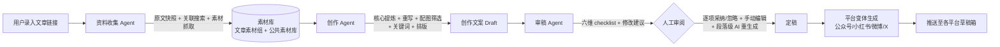

# 00 · 产品总览

## 一句话定位

输入一篇 AI 行业要闻（大模型 / 具身智能 / 芯片 / AI 软硬件）的链接，应用自动完成**资料收集 → 再创作 → 审稿 → 人工定稿**，产出尊重事实、标注来源、低 AI 味、低撞稿风险的中文科技解读文案，并适配公众号 / 小红书 / 微博 / X 的格式，一键推送到各平台**草稿箱**（最终发布动作由用户在平台上手动完成）。

## 核心流程

三个 Agent 不是黑盒串联：每一步产物落盘、可检视、可回退，人工关卡（Human-in-the-loop）是流程的一等公民，而不是事后补丁。

## 第一阶段已确认决策（来自需求讨论，设计文档的约束条件）

| # | 决策 | 设计落点 |
|---|---|---|
| 1 | 本轮只做本地部署；后续统一部署到支持 Python 的平台，支持一键安装、一键启动 | 见 `07`，本地用 conda `xkd_env_py312`；一键化脚本列入 M3 |
| 2 | 关联搜索时间窗口：新闻发布日期前后 3 天，可配置 | `search_window_days=3`，见 `02` 收集 Agent 与 `07` 配置 |
| 3 | 允许时间窗口外补入直接相关的原始论文 / 基础科普 | 收集 Agent 的「基础资料补入」通道，标记 `foundational=true` |
| 4 | 配图/视频优先用素材库；支持手动添加（GUI 上传或直接拷贝进文件夹） | 素材摄取流水线监听文件变化，见 `03` |
| 5 | 统一语言风格：**轻松诙谐但不失严谨与科学性，有「技术传火人/布道师」人设**（2026-10-24 由「专业克制」修订为此，附 14 篇范文链接作 few-shot 与测试样例）；保留关键技术细节；需要一份单独的 prompt 调优文档 | 见 `06-style-guide.md`，风格包 `config/styles/tech-evangelist/` |
| 6 | 分页形式参考小红书图文：表达清晰前提下尽量美观有吸引力 | 卡片组图生成器，见 `01`/`04` |
| 7 | 参考资料中的一段或多段可经 LLM 融合改写后插入文案；手机上不做此功能 | 编辑器「资料插入」浮窗，PC 端限定，见 `04` |
| 8 | 素材库分**文章素材库**（以文章为组）和**公共素材库**；编辑某篇时默认只打开本组 + 公共库 | 数据模型与前端面板，见 `03`/`04` |
| 9 | 文案打开默认为 Markdown 阅览模式，双击进入编辑 | 块编辑器交互，见 `04` |
| 10 | 文案中的图片/视频默认显示，人工审阅后手动去除/替换 | 审稿流程与编辑器图片操作，见 `02`/`04` |
| 11 | 创作需 3~5 篇参考素材；素材稀缺主题可只用 1~2 篇 | 收集 Agent 的参考篇数下限/上限配置，见 `02` |
| 12 | 支持手动添加参考素材：网址（需爬取）/文档/图片/视频 | 素材摄取统一入口，见 `03` |

## 设计原则

1. **本地优先（Local-first）**：所有数据（素材、草稿、配置、日志）保存在本地，密钥只进 `.env`，不上传任何第三方。
2. **模块化 + 可插拔**：爬虫、搜索引擎、LLM 渠道、发布平台、排版主题、风格包全部是插件/适配层。核心教训来自 `wechat-article-exporter`——2026 年 7 月因微信关闭上游接口而停更归档。**凡依赖平台内部接口的环节必须可替换、可降级**。
3. **人机协同**：Agent 负责产出和建议，人负责判断。审稿 Agent 输出的是「带证据的 checklist」，采纳权在人。
4. **一切落盘、一切有版本**：素材有快照，文案有版本链，审稿有记录，便于回溯与复盘。
5. **合规底线**：尊重事实、标注来源、原创度阈值不达标不放行；平台 RPA 能力默认向「草稿箱」而非直发。

## 名词约定

| 名词 | 含义 |
|---|---|
| **任务 / Article** | 一次「输入链接 → 产出文案」的完整处理单元，贯穿整个流水线 |
| **素材 / Material** | 文本片段、图片、视频、文档等创作原料，存在于素材库 |
| **素材库 / Library** | 文件系统 + SQLite 索引的素材存储，分公共库与文章素材组 |
| **文案 / Draft** | 创作 Agent 产出、经人工编辑后的创作内容，以「文档块模型」表示 |
| **定稿 / Final** | 人工确认后的某一版 Draft，用于生成平台变体 |
| **变体 / Variant** | 按平台格式（公众号 HTML / 小红书分页卡 / 微博短文 / X 推文串）适配后的发布单元 |
| **checklist** | 审稿 Agent 输出的结构化问题清单，逐项可采纳/忽略/AI 修复 |
