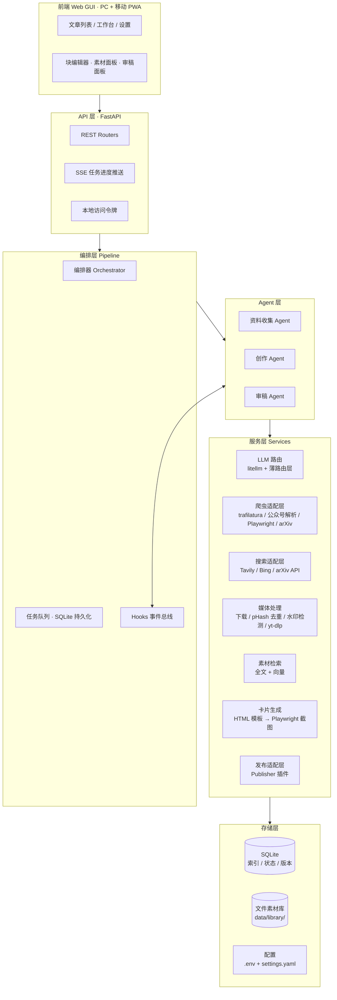

# 01 · 总体架构

## 分层视图



## 技术选型

| 层 | 选型 | 理由 |
|---|---|---|
| 后端 | Python 3.12 + FastAPI + Uvicorn | 与 conda `xkd_env_py312` 对齐；FastAPI 自带 OpenAPI 文档，便于调试 |
| 数据库 | SQLite（WAL 模式） | 本地单用户零运维；状态、版本、索引一库搞定 |
| 任务队列 | 进程内 asyncio 队列 + SQLite `jobs` 表持久化 | 本地单用户不需要 Celery/Redis；重启可恢复 |
| LLM 调度 | **litellm SDK** + 自建薄路由层 | litellm 统一 100+ 提供商接口（`provider/model` 字符串路由）；薄层实现渠道优先级、失败降级、token 成本日志——不必自建网关，借鉴 new-api 的「渠道优先级 + 亲和性」思想即可 |
| 结构化输出 | Pydantic + JSON Schema（约束解码/函数调用） | 三个 Agent 的输出都必须 schema 化，杜绝「模型随口一说」 |
| 爬虫 | trafilatura（主）+ 自写公众号解析器 + Playwright（兜底） | 公众号正文是静态 HTML，直接解析 `#js_content` 节点比通用提取器还原更准；JS 重页面（X、部分官网）走 Playwright |
| 论文 | arXiv API + pypdf | 新模型/论文类要闻的标准来源 |
| 视频 | yt-dlp（X / B站 支持好）+ 微博走 Playwright 抓包补位 | yt-dlp 的微博 extractor 脆弱，需要降级链 |
| 搜索 | Tavily（有 key 优先）→ DuckDuckGo HTML（零配置兜底）；arXiv 搜索器专供论文 | 关联搜索不依赖任何 key 也能工作；限频时单篇失败不阻断主流程 |
| 媒体补充 | Pexels / Pixabay API（图+视频，用现有 key） | 原文配图不足时按主题关键词补可商用素材，带来源署名 |
| 查重 | SimHash（字符 n-gram  shingles，无第三方依赖）+ 向量余弦 | 字面 + 语义双阈值，见 `02` 审稿 |
| 向量 | **OpenAI 兼容 embedding API**（火山方舟 doubao-embedding 等）；不可用时降级纯 FTS5 | 已拍板（2026-10-24）：不本地装 torch 大模型，接口预留本地 ONNX 扩展 |
| 卡片组图 | 自写 HTML 模板 + Playwright 截图出 PNG | 参考 guizang-social-card-skill 的管线模式（AGPL，只借鉴不自用代码） |
| 前端 | Vue 3 + Vite + Pinia + Vue Router + TailwindCSS + PWA | 响应式 + 可「添加到主屏幕」，覆盖 PC 与手机浏览器 |
| 前端编辑器 | 自研块编辑器（预览默认 / 双击编辑） | 段落级再生成、图片替换天然落在块模型上，见 `04` |
| 公众号排版 | doocs/md 主题 CSS 思路（WTFPL 协议） | Markdown → 公众号排版 HTML 的成熟方案 |

## 代码结构（M1 已实现，2026-10-25 与代码核对同步）

```
app/
├── main.py                  # FastAPI 组装: 初始化 DB/配置覆盖/hooks/队列, 挂载路由与静态前端
├── __main__.py              # python -m app 启动入口 (--host/--port/--reload)
├── core/
│   ├── config.py            # 三层配置合并: 默认 < config/settings.yaml < DB settings 表; .env 密钥
│   ├── models.py            # Pydantic 领域模型 (ArticleStatus/Block/DraftDoc/ChecklistItem/Variant...)
│   ├── blocks.py            # 文档块操作 + Markdown 导出 + [^mat_*] 引用标记剥离
│   ├── statemachine.py      # Article 状态机 (见 02; 非法迁移抛错, 同态迁移幂等)
│   ├── events.py            # 进程内事件总线 (SSE 订阅 + hook 触发)
│   └── ids.py               # 带前缀短 id (art_/mat_/drf_/rev_/ri_/job_/pj_)
├── agents/
│   ├── base.py              # AgentBase: config/prompts 模板渲染 / 风格包加载 / LLM 调用封装
│   ├── collector.py         # 资料收集: 抓取→主题提炼→关联搜索(网页+arXiv)→媒体补充→notes.md
│   ├── creator.py           # 创作: 证据包 grounding→成稿→词数控制→必配图兜底→分页; 段落重生成/融合插入
│   └── reviewer.py          # 审稿: layout/banlist/originality 规则 + LLM 四维, 输出 checklist
├── services/
│   ├── llm/router.py        # OpenAI 兼容薄路由: 渠道优先级+fallback+schema 校验重试+成本日志
│   ├── crawl/               # 爬虫插件 (registry 分派): wechat_mp / trafilatura / arxiv / fixture
│   ├── search/              # 搜索插件: tavily / duckduckgo(零配置兜底) / arxiv(论文) / registry
│   ├── media/               # download.py(防盗链 Referer+并发下载) / stock.py(Pexels+Pixabay 补充) / watermark.py
│   ├── rag/index.py         # 素材检索: FTS5 trigram(短语化+LIKE 兜底) + embedding 向量(可选)
│   ├── dedup/similarity.py  # 字符 n-gram SimHash + Jaccard 查重
│   ├── embed/embedder.py    # ApiEmbedder(OpenAI 兼容) / NullEmbedder(降级)
│   ├── cards/render.py      # 小红书卡片: 主题模板渲染 + 浏览器内分页/溢出校验 + Playwright 截图
│   │   └── themes/tech-note/  # 「编辑部快报」主题 (theme.yaml + theme.html)
│   ├── publish/             # Publisher 插件接口 base.py + exporter.py(统一导出包, 一阶段唯一实现)
│   └── draft_service.py     # 草稿版本服务: 一切修改产生新版本+落盘+增量复审判断(update_meta 等 op)
├── pipeline/
│   ├── orchestrator.py      # 阶段推进/准入 STAGE_ENTRY/auto 连跑/软审(定稿后复审不动状态)
│   ├── queue.py             # 后台线程 + jobs 表持久化, 崩溃恢复, 失败重试(上限 2)
│   └── hooks.py             # config/settings.yaml 注册的 shell hooks (事件占位符替换)
├── storage/
│   ├── schema.sql           # 全量建表 (articles 含 lib_dir)
│   ├── db.py                # 连接/WAL/FTS5 初始化与降级标记/轻量迁移
│   ├── dao.py               # 类型化 DAO (全部 SQL 集中)
│   └── library.py           # 素材库文件系统: 标题命名文件夹/中文分项/sha256 去重/图片嗅探
└── api/
    ├── articles.py          # 文章 CRUD + 阶段推进 + 定稿/回炉 + jobs 列表
    ├── materials.py         # 素材列表/上传/网址摄取/inbox 扫描/删除/文件与文本直取
    ├── drafts.py            # 草稿读取/版本/批量编辑/段落重生成/融合插入
    └── ops.py               # 审稿报告与条目处理/发布导出/卡片生成/设置/SSE/health

web/                         # 前端源码 (Vue3 + Vite + TS + Naive UI + Tailwind)
├── src/views/               # ArticleList(三态列表) / Workbench(四 tab 工作台) / Settings
├── src/components/          # StatusChip / MaterialsPanel / BlockEditor(块编辑器+meta 三独立框)
│                            #   / ReviewPanel(checklist 联动+采纳即修复) / PublishPanel(导出+卡片预览)
├── src/stores/app.ts        # 全局 store + SSE 事件驱动刷新
└── src/api.ts               # fetch 封装(令牌) + SSE 客户端
config/                      # 一切可手动调整的提示词与参数 (拍板 2026-10-24)
├── settings.yaml            # 非密钥参数 (窗口/阈值/模型档位/并发/hooks)
├── prompts/                 # Jinja2 模板: collector/topic_extract, creator/{draft,regenerate,
│                            #   insert_refs,compress}, reviewer/review
└── styles/tech-evangelist/  # 风格包: style.yaml / system.md / rules.md / banlist.txt / fewshots/
data/                        # 唯一数据根 (gitignore): app.db + library/ + drafts/
docs/                        # design/(本文档集) + api.md + user-manual.md + dev-plan.md
tests/                       # pytest: core/storage/agents/exporter/api e2e (离线 fixture + FakeLLM)
scripts/                     # (预留) 通知/备份等 hook 脚本
.env                         # 密钥 (不进 git)
```

**与目标形态的差异说明**：`app/plugins/` 未单列——插件点用 services 下的 registry 模式实现
（crawl/registry.py、search/registry.py、publish/base.py 的 Publisher 协议、cards/themes/ 目录即主题插件），
二阶段接入公众号 API/RPA 时在 publish/ 下新增实现即可；`errors.py`/`logging_setup.py` 未单列，
错误收敛在路由层与编排器（见 api.md 错误约定），日志暂用 uvicorn 默认。

## LLM 路由层设计

> 实现细化（2026-10-24）：一阶段先实现内置 OpenAI 兼容客户端（DeepSeek / 火山方舟 / OpenAI 均兼容，轻量、可无网络单测），接口与 litellm 的 `provider/model` 路由约定保持一致；litellm 作为可选后端留扩展口。

配置示例（`config/settings.yaml`）：

```yaml
llm:
  channels:                      # 渠道 = 某 provider 的一组 key
    - name: deepseek-main
      provider: deepseek
      env_key: DEEPSEEK_API_KEY
      priority: 1
    - name: ark-backup
      provider: volcengine       # 火山方舟, OpenAI 兼容
      env_key: ARK_API_KEY
      priority: 2
  routing:                       # 按用途分配模型档位
    summarize:   { model: deepseek/deepseek-chat,  temperature: 0.3 }
    rewrite:     { model: deepseek/deepseek-chat,  temperature: 0.7 }
    review:      { model: deepseek/deepseek-reasoner, temperature: 0.2 }  # 审稿可用推理模型
    vision:      { model: volcengine/doubao-vision, temperature: 0.2 }    # 图片水印/内容判断
  fallback: [deepseek-main, ark-backup]   # 失败按序降级
  cost_log: true                 # 每次调用记录 tokens 与估算成本
```

要点：

- **按用途而非按 Agent 分配模型**：同一 Agent 内「摘要用便宜档、成稿用强档」；审稿用不同渠道做交叉验证可降低同源盲区。
- 每次调用落 `llm_calls` 表（渠道、模型、tokens、耗时、所属任务/阶段），成本可审计。
- 结构化输出失败（schema 校验不过）自动带错误信息重试一次，再失败进入人工可见的失败态。

## 扩展机制（重点：这是产品级的可扩展设计）

### 1. 插件（Plugins）

四类插件点，统一约定：目录 `plugins/<name>/` 含 `plugin.yaml`（名称、类型、版本、入口）+ 实现文件；启动时扫描注册。

| 插件类型 | 接口 | 内置实现 |
|---|---|---|
| Crawler | `can_handle(url) -> bool` / `fetch(url) -> RawArticle` | trafilatura、wechat_mp、arxiv、playwright_generic |
| Searcher | `search(query, window) -> list[SearchResult]` | tavily、bing、arxiv |
| Publisher | `capabilities()` / `push(variant) -> PushResult` | 公众号 API、RPA 驱动、导出包（见 `05`） |
| CardTheme | 模板目录（HTML+CSS+分页规则） | 2~3 套小红书主题 |

### 2. Hooks（事件钩子）

流水线关键事件可挂用户脚本（`settings.yaml` 注册 shell 命令或 Python callable）：

```
article.added        collect.finished      rewrite.finished
review.finished      draft.finalized       publish.finished   job.failed
```

典型用途：自动推进下一阶段（`auto_pipeline: true` 时等价于内部推进）、定稿后微信/邮件通知、每次落盘后自动 git commit 备份。

### 3. MCP（双向）

- **作为 MCP Client**：消费外部工具服务器（如 tavily-mcp、playwright-mcp），把「搜索」「浏览器动作」外包给成熟 MCP 服务，配置里启用即可。
- **作为 MCP Server**：把素材库检索、草稿读写、发布推送暴露为 MCP 工具（参考 XHS-Downloader 的 CLI/API/MCP 三入口形态），让 ZCode / Claude 等外部 Agent 也能驱动本应用。

### 4. 风格包（Style Packs）

写作风格做成可热插拔的目录包（类似「技能包」）：

```
config/styles/tech-evangelist/   # 默认: 轻松诙谐+严谨科学的技术传火人/布道师人设
├── style.yaml                   # 名称、适用平台、词数区间、温度
├── system.md                    # 系统提示词
├── rules.md                     # 风格规则 (链接到 06 文档的规则集)
├── banlist.txt                  # 禁用词/AI 套话表
├── fewshots/                    # 2~4 篇范文对 (原文→成稿), 从范文库蒸馏
└── layout/                      # 配套排版/卡片模板
```

设置中按平台绑定风格包；调优方法见 `06-style-guide.md`。

## 并发与运行模型（实现版）

- 本地单用户：**一个后台工作线程** + `jobs` 表持久化队列（非协程），阶段任务串行执行；
  媒体下载内部用 `ThreadPoolExecutor` 有界并发（默认 4），LLM 阶段不复用连接。
- 任务重试上限 2 次；进程重启后 `running` 任务自动重置为 `pending` 续跑；
  准入校验含「自身进行态」使重试幂等；定稿/发布态下的复审为软审（只出报告不动状态）。
- 长任务（收集、创作、审稿、卡片渲染、导出）通过 `/api/sse` 向前端推送进度事件，前端 store 驱动刷新。

## 安全与边界

- 密钥只读 `.env`；`config/settings.yaml` 与 DB 里**不存密钥**，设置页只显示渠道是否已配置。
- 爬虫/下载带 UA 与防盗链 Referer 规则；LLM 与搜索走各自渠道超时与重试。
- 本地 API 默认绑定 `127.0.0.1`；`--host 0.0.0.0` 局域网/手机访问时需在 `.env` 设
  `APP_ACCESS_TOKEN`（中间件校验 `?token=` 或 `Authorization: Bearer`）。

## 开放问题

1. ~~向量索引选型~~ 已落地：OpenAI 兼容 embedding API（如火山方舟），不可用降级纯 FTS5。
2. 是否需要多用户？（当前按单用户；未来多人协作需提前留认证与数据隔离口）
