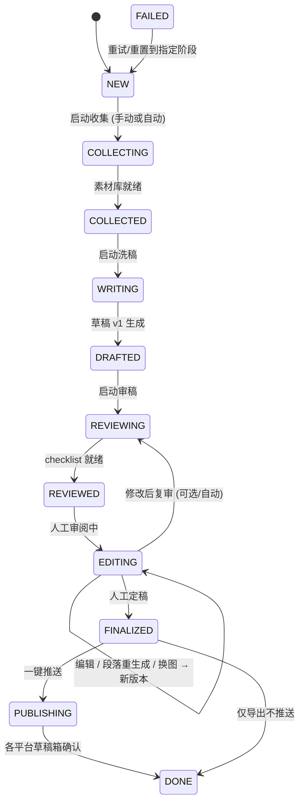

# 02 · Agent 设计与流水线

## 任务状态机

细粒度状态（内部）与 UI 三态（New / Process / Done）的映射：



| UI 状态 | 内部状态 |
|---|---|
| **New** | `NEW` |
| **Process** | `COLLECTING → REVIEWED`（Agent 自动阶段）+ `EDITING` |
| **Done** | `FINALIZED / PUBLISHING / DONE`（发布结果以平台徽标单独展示） |

「修改后复审」规则：手动编辑若改动超过阈值（默认改动块数 ≥3 或字数变化 >20%，可配），自动触发一次增量复审（只审改动的块及其上下文），保证定稿始终经过审稿关。

## 编排模式

- **Manual 模式（默认）**：每阶段完成即暂停，等用户在 GUI 点击「下一步」。适合打磨期。
- **Auto 模式**：`collect.finished → rewrite → review` 自动连跑，到 `REVIEWED` 必停（人工关卡不可跳过）。
- 编排器只做状态推进与任务派发，不含业务逻辑；业务全在 Agent 与服务层，便于单测。

---

## Agent 1 · 资料收集 Collector

**输入**：`{ url, user_notes?, search_window_days=3, allow_foundational=true, ref_count=[3,5] }`
**输出**：写入素材库 + `collection_report`（结构化 JSON，落盘并入库）

### 步骤

1. **原文抓取与快照**
   - 爬虫插件按 URL 分派：公众号走自写解析器（`#js_content` 节点 + `data-src` 懒加载还原 + 带 Referer 下图，绕防盗链）；arXiv 走 API 拿元数据 + PDF；X/JS 重页面走 Playwright；其余 trafilatura。
   - 原文 HTML + 规范化 Markdown + 全部媒体存为不可变快照（后续审稿的「事实基准」）。
2. **主题提炼**（LLM，summarize 档）：输出 `topic / keywords[] / core_points[] / entities[] / published_at`，作为关联搜索的种子。
3. **关联搜索**
   - 时间窗口：以原文发布日为中心 ±`search_window_days`（默认 3），用 keywords + entities 组合查询，目标凑齐 **3~5 篇**参考（配置 `ref_count_min/max`）；稀缺主题允许 1~2 篇并在报告中显式标注 `scarce=true`。
   - **基础资料补入**：若核心论点涉及某论文/基础概念（如某架构、某芯片制程），允许跳出窗口补入原始论文或权威科普，标记 `foundational=true`，在成稿中作为背景引用。
   - 去重：URL 规范化 + 标题向量去重；同主题多来源时优先官方博客/论文/主流媒体。
4. **素材抓取**
   - 每篇参考同样做快照；图片全部下载 → pHash 去重 → 水印初筛（见下）→ 记录尺寸/来源；视频用 yt-dlp 取回（失败记原因）。
5. **整理入库**：写素材索引，生成 `notes.md`（主题/关键词/核心论点/素材清单），触发 `collect.finished`。

### 水印检测（两道）

1. 启发式：角落半透明 logo 模板匹配 + 已知平台水印特征（公众号、微博、小红书、B站角标）；
2. 拿不准的走 vision 档模型问一句「此图是否含水印/平台标识」。检出即标 `watermark=true`，洗稿选图时默认排除（用户可覆盖）。

---

## Agent 2 · 洗稿 Rewriter

**输入**：`{ article_id, style_pack, target_word_count, outline_hint? }` + 素材库检索结果
**输出**：`DraftDoc v1`（文档块模型，见 `03`）+ 元数据（关键词、一句话总结、分页建议）

### 步骤

1. **事实底座**：从素材库构建「证据包」——核心论点 + 关键数据 + 来源映射（`claim → [material_ids]`），作为生成上下文，强制引用素材而非自由发挥。
2. **大纲**：LLM 出 2 个候选大纲（观点线 / 科普线），默认选第一个，用户可在编辑器重生成本步。
3. **成稿**：按风格包逐节生成；词数按 `target_word_count`（平台默认值见 `05`）控制，超限时走「压缩 pass」而非截断。
4. **配图筛选**：按段落语义从素材库选图（向量匹配 + 过滤 `watermark=true`），图片块带 `asset_id` 与来源说明；**默认全部显示**，是否去除由人工决定。
5. **元数据**：生成 `keywords[]`、`one_liner`（一句话总结，用于列表页与 X/微博开头）、`title_candidates[]`（3 个标题候选）。
6. **排版**：产出两种视图——Markdown 文档块（编辑主格式）+ 小红书分页方案（`pages[]`，每页标题/正文/配图，供卡片生成器用）。

### 再生成与插入（编辑期能力，也归此 Agent）

- **段落级重生成**：输入选中的块 id 列表 + 用户指令（如「更口语一点」「压到 100 字」），只重写这些块，保持上下文衔接；产出新版本。
- **资料融合插入**：用户在素材面板勾选 1~N 段参考文本 + 插入位置 + 指令 → LLM 融合改写为与原稿风格一致的一段 → 插入为带引用标记的新块（PC 端限定功能）。

---

## Agent 3 · 审稿 Reviewer

**输入**：`DraftDoc` 当前版本 + 素材库证据包 + 原文快照
**输出**：`ReviewReport { items: ChecklistItem[], scores }`，`auto_fixable` 项可一键 AI 修复

### 六维检查与实现手段

| 维度 | 检查内容 | 实现 |
|---|---|---|
| **layout 排版** | 段落过长、标题层级混乱、图密度不均、移动端阅读节奏、小红书每页字数 | 纯规则引擎（不调 LLM），直接给出块级定位 |
| **fact 技术细节** | 数字、型号、指标、人物/机构表述是否与素材一致 | 抽取 claims → 素材库检索证据 → LLM 判定 supported / unsupported / conflicting，附来源 |
| **attribution 来源** | 关键事实是否有明确出处 | 统计引用覆盖率；无源关键事实标 `warn` |
| **compliance 平台审核** | 广告法违禁词、敏感词、夸大宣传、时政/医疗等高危领域擦边 | 本地词表匹配 + LLM judge（按目标平台规则集） |
| **originality 撞稿风险** | 与原文/参考篇的字面与语义相似度 | SimHash 字面相似度 + 中文向量余弦；默认阈值：字面 ≥0.35 或语义 ≥0.75 → `blocker`，必须重构对应段落（阈值可配） |
| **ai_flavor AI 味** | 套话密度、连接词滥用、过度排比、空洞总结 | 统计特征（句长方差、虚词密度）粗筛 + LLM rubric 打分 1~5 + 改写建议；可选接商用检测 API 抽检（朱雀等，配置启用） |

### ChecklistItem 结构

```json
{
  "id": "ri_xxx",
  "category": "fact|attribution|compliance|originality|ai_flavor|layout",
  "severity": "info|warn|blocker",
  "block_id": "b_12",
  "message": "「性能提升 40%」与来源不符，素材 m_7 中为 27%",
  "suggestion": "改为 27% 或补充另一来源",
  "evidence": ["m_7"],
  "auto_fixable": true,
  "status": "pending|accepted|dismissed|fixed"
}
```

约定：**存在任何 `blocker` 时不允许定稿**（前端禁用定稿按钮，除非用户显式「强制定稿」并留痕）。

### 人机协同流程（核心交互）

1. 审稿完成 → 前端 checklist 面板按 severity 排序，点击条目联动高亮对应块。
2. 用户对每项可：**采纳 → AI 修复**（按 suggestion 重写该块，产生新版本）/ **忽略**（需可选填理由）/ **手动改**（进编辑态）。
3. 全部处理完 → 「定稿」→ 版本链锁定该版为 Final。
4. 审稿结论回流：被采纳/忽略的模式统计出来，作为风格包与 prompt 迭代的输入（见 `06`）。

## 失败与重试

- 每阶段重试上限 2 次；LLM 调用按渠道 fallback 链降级。
- **重试幂等**（2026-10-25 补）：阶段准入状态集含「自身进行态」（如 review 任务允许从
  REVIEWING 重入），同态迁移为 no-op——首次尝试把状态推进到进行态后失败，重试不会被准入挡下。
- **软审**：FINALIZED/PUBLISHING/DONE 状态下触发的复审（如定稿后编辑触发的增量复审）
  只产出报告、不改动文章状态，避免定稿被后台任务拽回编辑态。
- 爬虫失败不阻断主流程：单篇参考失败记 `fetch_error`，只有**原文快照失败**才让任务进 `FAILED`。
- 所有 Agent 输入/输出落盘（`data/drafts/<id>/runs/`），便于复现「这稿是怎么写出来的」。

## 开放问题

1. ~~审稿的 originality 阈值策略~~ **已拍板（2026-10-24）**：双保险——洗稿 Agent 用 prompt 硬约束（禁逐句改写、要求重构表达）做前端预防；审稿 Agent 做强约束，超标即 `blocker` 并附**具体修改指导**（指出高相似片段 + 重构建议，`auto_fixable=true`）。阈值初值 0.35/0.75 先用，M2 用真实数据校准。
2. 增量复审的触发阈值是否合适，是否允许用户手动关？
3. 是否引入「多模型交叉审稿」（用非成稿所用渠道的模型审 fact 维度）？成本换可靠，默认关。**已拍板**：AI 味检测优先借鉴开源方案/skill，商用 API 仅做效果调研，默认不接。
